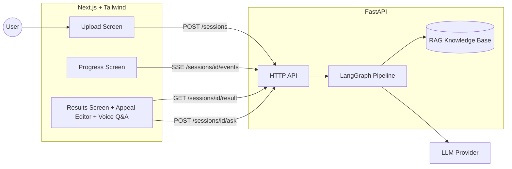
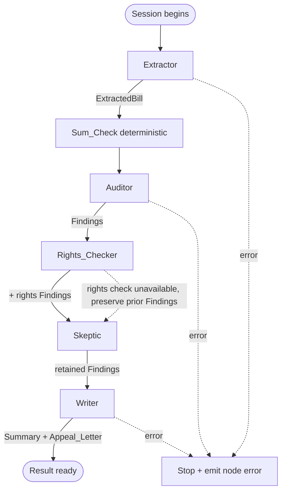
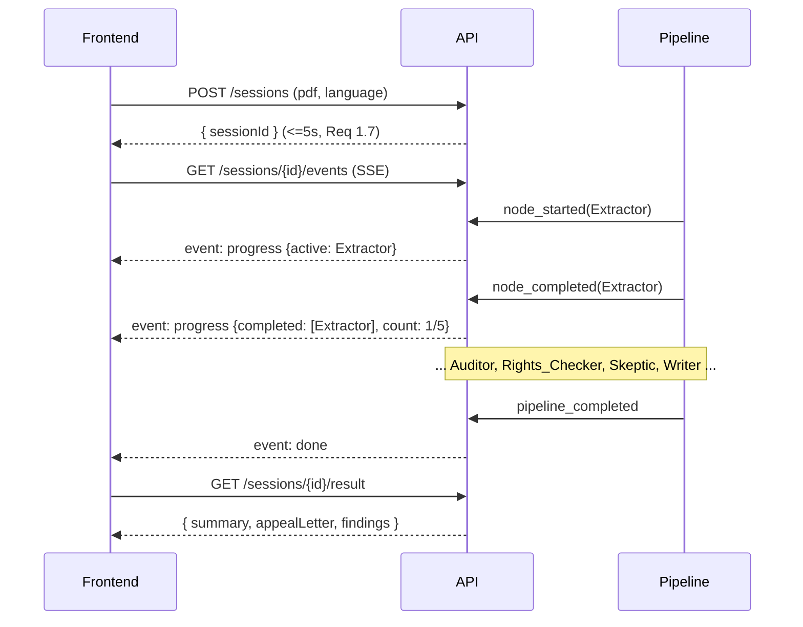

# Design Document

## Overview

Boston Bill Party is a multi-agent patient-advocate application. A user uploads a synthetic medical bill PDF; the backend runs a LangGraph pipeline of five nodes (Extractor → Auditor → Rights_Checker → Skeptic → Writer) and streams live progress to the frontend; the user reviews and edits a drafted appeal letter before any send action.

The central design tension is trust. Billing math must be verifiable, so arithmetic is never delegated to the LLM — a deterministic `Sum_Check` and the auditor's per-line math comparisons use exact decimal arithmetic. The LLM is used only where natural-language judgment is required: structuring raw PDF text into a schema, retrieving and interpreting rights passages, scoring finding confidence, and drafting prose. A dedicated Skeptic node then removes weak findings before anything reaches the user.

The design is deliberately pragmatic. It targets a single developer building an MVP in roughly seven hours, so it favors in-process state over a database, a file-backed RAG index over a managed vector store, and a thin provider abstraction over a plugin framework. Delivery order is MVP (Extractor → Auditor → Writer → UI) first, then Rights_Checker, Skeptic, voice Q&A, and the evaluation harness. These later nodes are designed as additive stages on a shared pipeline state so the MVP path works end to end before they exist.

### Technology Choices

| Concern | Choice | Rationale |
|---|---|---|
| Backend framework | Python FastAPI | Async HTTP, native SSE via `StreamingResponse`, Pydantic integration |
| Orchestration | LangGraph | Sequential node graph with a shared typed state object; matches the five-node requirement |
| PDF text | pdfplumber | Required by Req 2.1; reliable page-ordered text extraction |
| Schema/validation | Pydantic v2 | Required `ExtractedBill` schema; strict validation yields precise field errors (Req 2.6) |
| Decimal math | Python `decimal.Decimal` | Exact arithmetic for Sum_Check (Req 3.3, 3.4) |
| LLM access | Thin `LLMProvider` abstraction over provider SDKs, selected by `.env` | Swap providers without code change (Req 11) |
| RAG | Local embedded index (sentence-transformers + in-memory cosine search over a small JSON corpus) | Ten-ish MA patient-rights docs; no external vector DB needed at this scale |
| Frontend | Next.js (App Router) + Tailwind | Three screens, SSE consumption, Web Speech API access |
| Progress transport | Server-Sent Events | One-way server→client streaming fits per-node progress (Req 9) |
| Voice | Browser Web Speech API with text fallback | Req 10; no server-side speech dependency |

## Architecture

### System Context



### Pipeline Flow



The Sum_Check is drawn as a deterministic step feeding the Auditor because Req 3 computes it in the Backend (not the LLM) and the Auditor records the resulting math-error Findings (Req 3.2, 3.5, 3.6). Implementation-wise it is a pure function invoked at the start of the Auditor node.

### Progress Streaming



### Session State and Concurrency

Each upload creates an in-memory `Session` keyed by a UUID, holding the selected language, pipeline status, per-node progress, the evolving `PipelineState`, and an async event queue that the SSE endpoint drains. The pipeline runs as a background async task started when the session is created. This keeps the POST response fast (Req 1.7) while progress streams independently. Sessions are process-local and ephemeral, consistent with synthetic-only, no-persistence operation (Req 12.1).

## Components and Interfaces

### Backend Modules

```
backend/
  main.py                 # FastAPI app, routes, SSE
  config.py               # .env load + LLM provider config validation (Req 11)
  sessions.py             # Session registry, background task launch
  pipeline/
    state.py              # PipelineState (LangGraph state shape)
    graph.py              # LangGraph assembly of the five nodes
    extractor.py          # PDF read + LLM structuring -> ExtractedBill (Req 2)
    sumcheck.py           # deterministic Sum_Check (Req 3) — pure
    auditor.py            # duplicate / math / suspicious-code detection (Req 3,4) — pure
    rights_checker.py     # RAG retrieval + rights Findings (Req 5)
    skeptic.py            # confidence/evidence filtering (Req 6) — pure
    writer.py             # Summary + Appeal_Letter in selected language (Req 7)
  rag/
    knowledge_base.py     # load corpus, embed, cosine retrieval
    corpus/               # MA patient-rights reference documents (JSON)
  llm/
    provider.py           # LLMProvider abstraction + factory (Req 11)
  models.py               # Pydantic: ExtractedBill, LineItem, Finding, etc.
  eval/
    harness.py            # run pipeline over Eval_Set, score (Req 13)
    eval_set/             # 10 synthetic bills + planted-error manifests (Req 12)
```

### Node Responsibilities

**Extractor** (`extractor.py`) — Reads all PDF pages in order via pdfplumber and concatenates text (Req 2.1). If no text, returns a "no readable text" error and does not call the LLM (Req 2.7). Otherwise calls the LLM provider with a 60s timeout (Req 2.8) to produce JSON, then validates it against `ExtractedBill` (Req 2.2). Validation failures return per-field errors with no partial object (Req 2.6). Missing optional line-item fields become `null` (Req 2.4); amounts/unit prices are normalized to non-negative two-decimal `Decimal`, quantities to non-negative numeric (Req 2.5).

**Sum_Check** (`sumcheck.py`) — Pure function `compute_sum_check(bill) -> SumCheckResult`. Adds every line-item amount with `Decimal`; zero line items yields `0.00` (Req 3.1). Unparseable/missing amounts are excluded and flagged, not aborted (Req 3.5). Deterministic across repeated calls (Req 3.4). No LLM (Req 3.3).

**Auditor** (`auditor.py`) — Pure function over `ExtractedBill` + `SumCheckResult`. Emits Findings:
- math error when `|sum_check_total - stated_total| > 0.01` (Req 3.2), or stated total absent (Req 3.6), or line amount unparseable (Req 3.5);
- math error when `|amount - quantity*unit_price| > 0.01` per line (Req 4.3);
- duplicate charge grouping lines with identical code **and** description into one Finding referencing all (Req 4.2);
- suspicious code when a code is absent from the recognized set (Req 4.4) or missing entirely (Req 4.5).
Each Finding gets a `Confidence_Score` in [0,1] (Req 4.6). Zero line items → empty Findings (Req 4.7).

**Rights_Checker** (`rights_checker.py`) — Builds a query from the `ExtractedBill` and auditor Findings, retrieves up to 10 passages within 15s (Req 5.1). Passages with `Relevance_Score ≥ 0.7` for a potential issue become rights-issue Findings citing the passage (Req 5.2) with a confidence in [0,1] (Req 5.3); below-threshold issues are omitted (Req 5.4). On failure/empty/timeout it records no rights Findings, returns an "unavailable" status, and preserves auditor Findings (Req 5.5).

**Skeptic** (`skeptic.py`) — Pure filter. Drops Findings with confidence `< 0.5` (Req 6.2) or referencing zero line items **and** zero passages (Req 6.3). Keeps Findings with confidence `≥ 0.5` **and** at least one line-item or passage reference (Req 6.4). Empty result passes an empty set (Req 6.5).

**Writer** (`writer.py`) — With ≥1 retained Finding, produces a Summary with one entry per Finding and an Appeal_Letter with one contesting statement per Finding (Req 7.1, 7.2), both in the session language (Req 7.3). With zero retained Findings, produces a "no credible issues" Summary and no letter (Req 7.4). Generation failure returns an error with no partial output (Req 7.5).

### LLM Provider Abstraction (Req 11)

```python
class LLMProvider(Protocol):
    def complete(self, *, system: str, user: str, timeout_s: float,
                 node: NodeName) -> str: ...

def build_provider(config: LLMConfig) -> LLMProvider: ...
```

`config.py` loads `.env` at startup. Required keys (e.g. `LLM_PROVIDER`, `LLM_API_KEY`, `LLM_MODEL`) are validated: any missing/empty value aborts startup and names each missing variable (Req 11.2); an unsupported provider value aborts startup, names the bad value, and lists supported providers (Req 11.3). Per-node overrides (e.g. `LLM_MODEL_EXTRACTOR`) are applied to that node; otherwise shared values apply (Req 11.5). After valid startup all node LLM calls route through the configured provider with no code change (Req 11.4).

### HTTP API

| Method | Path | Purpose | Requirements |
|---|---|---|---|
| POST | `/sessions` | Upload PDF + language; validate; start pipeline; return `sessionId` within 5s | 1.1–1.7, 12.2 |
| GET | `/sessions/{id}/events` | SSE stream of progress/error/done events | 9.1–9.5 |
| GET | `/sessions/{id}/result` | Final Summary, Appeal_Letter, retained Findings | 7, 8.1 |
| POST | `/sessions/{id}/confirm` | Transmit current (edited) letter text after explicit confirm | 8.5–8.7 |
| POST | `/sessions/{id}/ask` | Voice/text Q&A about the analyzed bill; returns answer within 30s | 10.3, 10.6, 10.7 |
| POST | `/eval/run` | Run evaluation over the Eval_Set and return the report | 13 |

Upload validation order: reject non-PDF content type with a PDF-format message (Req 1.2); reject size outside [1 byte, 10 MB] with a range message (Req 1.3); reject unparseable PDFs as corrupt/unreadable (Req 1.6); reject input not marked synthetic (Req 12.2). Rejections retain no session.

### SSE Event Shapes

- `progress`: `{ activeNode, completedNodes: string[], completedCount, total: 5 }`
- `node_error`: `{ failedNode, message }` — frontend keeps prior completed state (Req 9.4)
- `done`: signals the result is ready
The frontend starts a 60s inactivity timer between events to show an interruption message (Req 9.5).

### Frontend Screens

- **Upload**: file picker + `Supported_Language` selector (default English, Req 1.5), records language (Req 1.4), POSTs the file.
- **Progress**: subscribes to SSE, shows active node and `completed/5`, updating within 2s (Req 9.1, 9.3); shows node-error and interruption states (Req 9.4, 9.5).
- **Results**: renders Summary + editable Appeal_Letter (≤20,000 chars, Req 8.3) within 2s (Req 8.1); retains edits until confirm (Req 8.4); requires explicit confirm before any send/export (Req 8.5–8.7); retry on writer failure without losing the Summary (Req 8.2). Voice Q&A control appears within 1s where supported (Req 10.1), transcribes and shows text before submit (Req 10.2), submits 1–500 char transcripts (Req 10.3), handles no-speech/transcription errors (Req 10.4, 10.5), reads and displays answers (Req 10.6), handles answer errors/timeouts (Req 10.7), and falls back to text input where unsupported (Req 10.8).

## Data Models

All monetary fields use `Decimal` serialized as strings with two decimals. Pydantic v2 with `extra="forbid"` so nonconforming LLM output yields precise field errors (Req 2.6).

```python
from decimal import Decimal
from enum import Enum
from typing import Optional
from pydantic import BaseModel, Field

class SupportedLanguage(str, Enum):
    EN = "en"; ES = "es"; PT = "pt"; HT = "ht"   # English, Spanish, Portuguese, Haitian Creole

class LineItem(BaseModel):
    id: str                                  # stable within a bill, used for references
    description: str
    billing_code: Optional[str] = None       # null when absent (Req 2.4)
    quantity: Optional[Decimal] = None        # non-negative (Req 2.5)
    unit_price: Optional[Decimal] = None      # non-negative, 2dp (Req 2.5)
    amount: Optional[Decimal] = None          # non-negative, 2dp (Req 2.5)

class ExtractedBill(BaseModel):
    provider_name: Optional[str] = None
    provider_address: Optional[str] = None
    account_number: Optional[str] = None
    line_items: list[LineItem] = Field(default_factory=list)
    stated_total: Optional[Decimal] = None    # None => Req 3.6 Finding

class FindingType(str, Enum):
    MATH_ERROR = "math_error"
    DUPLICATE_CHARGE = "duplicate_charge"
    SUSPICIOUS_CODE = "suspicious_code"
    RIGHTS_ISSUE = "rights_issue"

class Finding(BaseModel):
    id: str
    type: FindingType
    description: str
    confidence: Decimal = Field(ge=0, le=1)   # [0,1] (Req 4.6, 5.3)
    line_item_ids: list[str] = Field(default_factory=list)   # referenced lines
    passage_ids: list[str] = Field(default_factory=list)     # cited KB passages
    computed_total: Optional[Decimal] = None   # for math-error Findings (Req 3.2)
    stated_total: Optional[Decimal] = None

class SumCheckResult(BaseModel):
    computed_total: Decimal                    # 0.00 for empty (Req 3.1)
    excluded_line_item_ids: list[str] = Field(default_factory=list)  # Req 3.5

class RightsStatus(str, Enum):
    COMPLETED = "completed"
    UNAVAILABLE = "unavailable"                 # Req 5.5

class Passage(BaseModel):
    id: str
    text: str
    source: str
    relevance_score: Decimal = Field(ge=0, le=1)

class AnalysisResult(BaseModel):
    summary_entries: list[str]
    appeal_letter: Optional[str] = None         # None when no Findings (Req 7.4)
    retained_findings: list[Finding]
    language: SupportedLanguage
```

### LangGraph Pipeline State (Req 9, shared across nodes)

```python
class NodeStatus(str, Enum):
    PENDING = "pending"; RUNNING = "running"; COMPLETED = "completed"; ERROR = "error"

class PipelineState(BaseModel):
    session_id: str
    language: SupportedLanguage
    raw_text: Optional[str] = None
    bill: Optional[ExtractedBill] = None
    sum_check: Optional[SumCheckResult] = None
    findings: list[Finding] = Field(default_factory=list)   # auditor + rights
    retained_findings: list[Finding] = Field(default_factory=list)  # post-skeptic
    rights_status: RightsStatus = RightsStatus.COMPLETED
    result: Optional[AnalysisResult] = None
    node_status: dict[str, NodeStatus] = Field(default_factory=dict)
    error: Optional[dict] = None               # {failedNode, message} (Req 9.4)
```

### Evaluation Data Models (Req 12, 13)

```python
class PlantedError(BaseModel):
    id: str                                     # unique link to location (Req 12.4)
    expected_type: FindingType                  # required (Req 12.4, 12.5)
    line_item_id: Optional[str] = None

class EvalBill(BaseModel):
    id: str
    synthetic: bool = True                      # Req 12.1/12.2 marker
    pdf_path: str
    planted_errors: list[PlantedError] = Field(min_length=1, max_length=10)  # Req 12.3

class EvalReport(BaseModel):
    detected: int
    missed: int
    false_positives: int
    failed_bills: int                           # Req 13.3
    per_bill: list[dict]
```

The Eval_Set holds exactly ten `EvalBill`s (Req 12.3). A planted error without an `expected_type` makes the set invalid and raises an identifying error (Req 12.5). Matching (Req 13.4/13.5) compares a retained Finding's `type` and referenced `line_item_ids` against each planted error's `expected_type` and `line_item_id`.

## Correctness Properties

*A property is a characteristic or behavior that should hold true across all valid executions of a system — essentially, a formal statement about what the system should do. Properties serve as the bridge between human-readable specifications and machine-verifiable correctness guarantees.*

These properties target the pure, logic-bearing core of the pipeline: the deterministic Sum_Check, the Auditor's detection rules, the Skeptic's filter, language routing, config resolution, and evaluation scoring. UI rendering, SSE/voice streaming, latency bounds, and LLM/RAG I/O are validated by example, integration, and snapshot tests described in the Testing Strategy, not by properties.

### Property 1: Sum_Check equals the exact sum of parseable amounts

*For any* ExtractedBill, the Sum_Check computed total equals the exact decimal sum of every Line_Item amount that is present and parseable, and equals 0.00 when there are no such amounts (including the empty bill).

**Validates: Requirements 3.1, 3.5**

### Property 2: Sum_Check is deterministic

*For any* ExtractedBill, computing the Sum_Check two or more times yields an identical computed total on every execution.

**Validates: Requirements 3.4**

### Property 3: Bill-total mismatch produces a math-error Finding carrying both totals

*For any* ExtractedBill with a stated total, a math-error Finding that includes the computed total and the stated total is recorded if and only if the absolute difference between the Sum_Check total and the stated total exceeds 0.01.

**Validates: Requirements 3.2**

### Property 4: Unparseable amounts are excluded and flagged without aborting

*For any* ExtractedBill, every Line_Item whose amount is missing or unparseable is excluded from the Sum_Check total and is identified by a math-error Finding, while all parseable Line_Items remain included and the computation completes.

**Validates: Requirements 3.5**

### Property 5: Per-line math errors are flagged within tolerance

*For any* Line_Item with present quantity, unit price, and amount, a math-error Finding referencing that Line_Item is recorded if and only if the absolute difference between its amount and (quantity × unit price) exceeds 0.01.

**Validates: Requirements 4.3**

### Property 6: Duplicate charges are grouped into one Finding referencing all members

*For any* ExtractedBill, each maximal group of two or more Line_Items sharing an identical billing code and identical description produces exactly one duplicate-charge Finding that references all members of that group, and Line_Items not in any such group produce no duplicate-charge Finding.

**Validates: Requirements 4.2**

### Property 7: Missing or unrecognized codes produce a suspicious-code Finding

*For any* ExtractedBill, a suspicious-code Finding referencing a Line_Item is recorded if and only if that Line_Item has no billing code or a billing code absent from the recognized-code set.

**Validates: Requirements 4.4, 4.5**

### Property 8: All Findings carry a confidence in [0, 1]

*For any* ExtractedBill processed by the Auditor and Rights_Checker, every produced Finding has a Confidence_Score that is a decimal in the inclusive range 0 to 1.

**Validates: Requirements 4.6, 5.3**

### Property 9: Rights issues are recorded exactly at the relevance threshold

*For any* set of candidate rights issues each with its best supporting passage, a rights-issue Finding citing that passage is recorded if and only if the passage's Relevance_Score is at least 0.7.

**Validates: Requirements 5.2, 5.4**

### Property 10: Skeptic retains a Finding exactly when it is confident and evidenced

*For any* Finding, the Skeptic includes it in the set passed to the Writer if and only if its Confidence_Score is at least 0.5 and it references at least one Line_Item or at least one knowledge-base passage; otherwise it is excluded (so a set with no qualifying Findings yields the empty set).

**Validates: Requirements 6.2, 6.3, 6.4, 6.5**

### Property 11: Summary has one entry per retained Finding

*For any* non-empty set of retained Findings, the Writer's Summary contains exactly one entry per retained Finding and every entry identifies a distinct retained Finding.

**Validates: Requirements 7.1**

### Property 12: Output is tagged with the selected language

*For any* Supported_Language selected for a session with at least one retained Finding, the Writer generates its Summary and Appeal_Letter request tagged with that language and no other.

**Validates: Requirements 7.3**

### Property 13: Missing required config aborts startup naming exactly the missing variables

*For any* LLM configuration that omits or leaves empty one or more required values, startup aborts without initializing any node, and the reported error names exactly the set of missing required variables.

**Validates: Requirements 11.2**

### Property 14: Per-node config resolution prefers overrides then shared values

*For any* LLM configuration with an arbitrary subset of per-node overrides, each node's effective model and parameters equal that node's override when present and the shared configured value otherwise.

**Validates: Requirements 11.5**

### Property 15: Planted-error classification is detected-iff-matched

*For any* set of retained Findings and planted errors for a synthetic bill, each planted error is classified as detected if and only if at least one retained Finding matches it, each unmatched planted error is classified as missed, and each retained Finding matching no planted error is classified as a false positive.

**Validates: Requirements 13.4, 13.5**

### Property 16: Evaluation report totals conserve per-bill counts

*For any* collection of per-bill classifications across the Eval_Set, the report's detected, missed, and false-positive totals each equal the sum of the corresponding per-bill counts across all synthetic bills.

**Validates: Requirements 13.6**

## Error Handling

The pipeline treats errors as either **node-fatal** (stop the pipeline, emit a node error, preserve prior progress) or **node-local** (record a Finding or degraded status and continue). The distinction follows the requirements precisely.

| Source | Condition | Handling | Requirement |
|---|---|---|---|
| Upload | Non-PDF content type | 400 with PDF-format message; no session | 1.2 |
| Upload | Size outside [1 byte, 10 MB] | 400 with size-range message; no session | 1.3 |
| Upload | PDF content type but unparseable | 400 corrupt/unreadable; no session | 1.6 |
| Upload | Input not marked synthetic | 400 non-synthetic error; no processing | 12.2 |
| Extractor | No extractable text | Node-fatal error; LLM not invoked | 2.7 |
| Extractor | LLM output nonconforming | Node-fatal validation error naming each bad field; no partial object | 2.6 |
| Extractor | LLM timeout (60s) | Node-fatal timeout error | 2.8 |
| Sum_Check / Auditor | Line amount unparseable | Node-local: exclude + math-error Finding; continue | 3.5 |
| Auditor | Stated total absent | Node-local: absent-total math-error Finding; retain computed | 3.6 |
| Rights_Checker | Retrieval fails/empty/timeout (15s) | Node-local: no rights Findings, status "unavailable", preserve auditor Findings | 5.5 |
| Writer | Generation failure | Node-fatal error; no partial Summary/letter | 7.5 |
| Startup | Missing/empty required config | Abort startup; name each missing variable; no nodes initialized | 11.2 |
| Startup | Unsupported provider value | Abort startup; name value; list supported providers | 11.3 |
| Evaluation | Empty Eval_Set | Terminate; empty-set error; pipeline not run | 13.2 |
| Evaluation | Pipeline fails for a bill | Record failed; continue remaining; include failed count | 13.3 |

**Node-fatal propagation.** When a node raises, the pipeline sets `PipelineState.error = {failedNode, message}`, emits an SSE `node_error` event, and stops. The frontend shows the failing node and "analysis stopped" while keeping completed-node state (Req 9.4). The result endpoint returns the error plus whatever Summary already exists so the writer-retry path (Req 8.2) can function.

**Frontend resilience.** A 60s inter-event timer surfaces an interruption message (Req 9.5). Voice Q&A failures (no speech, transcription failure, answer timeout) show messages without discarding prior answers (Req 10.4, 10.5, 10.7).

## Testing Strategy

The system is tested with a dual approach: **property-based tests** for the pure logic core and **example / integration / snapshot tests** for everything that depends on external services, the browser, latency, or rendering. This split follows the PBT-applicability assessment in the prework: arithmetic, detection, filtering, config resolution, and scoring are pure functions with universal properties; the LLM, RAG, SSE, Web Speech API, and UI layers are not.

### Property-Based Tests

- **Library:** Hypothesis (Python) for backend logic. Do not reimplement PBT machinery.
- **Iterations:** each property test runs a minimum of 100 generated cases.
- **Tagging:** each property test carries a comment of the form
  `# Feature: boston-bill-party, Property {number}: {property_text}`.
- **Coverage:** one property-based test per correctness property (Properties 1–16). Generators produce random `ExtractedBill`s (varying line counts, amounts, codes, descriptions, missing/unparseable fields), random Finding sets (varying confidence and references), random LLM configs (varying missing keys and per-node overrides), and random planted-error/finding pairings for scoring.
- **Edge cases folded into generators:** empty bills (Req 3.1, 4.7), null stated totals (Req 3.6), all-excluded skeptic input (Req 6.5), and boundary differences at exactly 0.01 and relevance exactly 0.7.

### Example and Edge-Case Unit Tests

Concrete scenarios not suited to universal quantification:
- Upload validation messages and boundaries at 0 bytes / 1 byte / 10 MB / 10 MB+1 (Req 1.2, 1.3, 1.6, 12.2).
- Extractor empty-text short-circuit asserting the LLM mock is never called (Req 2.7); page-order concatenation on a fixed multi-page PDF (Req 2.1).
- Rights-check unavailable branch preserving auditor Findings (Req 5.5).
- Writer no-findings branch: "none detected" summary, no letter (Req 7.4); generation-failure branch (Req 7.5).
- Unsupported-provider startup error (Req 11.3); empty Eval_Set termination (Req 13.2); failing-bill resilience (Req 13.3).
- Eval_Set validity: exactly ten bills, 1–10 planted errors each, every planted error has an expected type and unique id; missing expected type is rejected naming the bill (Req 12.3, 12.4, 12.5).

### Integration Tests

Exercised with mocked or real external dependencies, 1–3 representative cases each:
- Session creation returns a `sessionId` within 5s (Req 1.7).
- Extractor → Auditor → Writer MVP path end to end on one synthetic bill (Req 2.2, 2.8 timeout via a delaying mock).
- Rights_Checker retrieval returns at most 10 passages within 15s against the real embedded corpus (Req 5.1).
- SSE: a full run emits one `node_started`/`node_completed` per node and a final `done` (Req 9.2).
- Provider routing: setting `LLM_PROVIDER` via env routes node calls to that provider (Req 11.4).
- `/ask` returns an answer or a timeout error within 30s (Req 10.6, 10.7).

### Frontend Tests

Component tests (React Testing Library) with mocked SSE, `fetch`, and Web Speech API:
- Progress screen updates active node and `completed/5`, node-error state, and 60s interruption message with a faked clock (Req 9.1, 9.3, 9.4, 9.5).
- Results screen renders within the result payload, editable field accepts up to 20,000 characters, retains edits, and requires an explicit confirm before any send/export; asserts the transmit call fires only after confirm and carries the current edited text (Req 8.1–8.7).
- Voice Q&A: control appears where `SpeechRecognition` exists, transcribes-then-shows before submit, submits 1–500 char transcripts, handles no-speech and transcription errors, reads and displays answers, and falls back to a text input where the API is absent (Req 10.1–10.8).
- Language selector records selection and defaults to English (Req 1.4, 1.5).

### Evaluation Harness as a Test Asset

The harness (`eval/harness.py`) doubles as a regression gate: running it over the ten-bill Eval_Set reports detected / missed / false-positive counts (Req 13.6). The scoring functions it uses are themselves covered by Properties 15 and 16, so the aggregate numbers rest on verified arithmetic.
