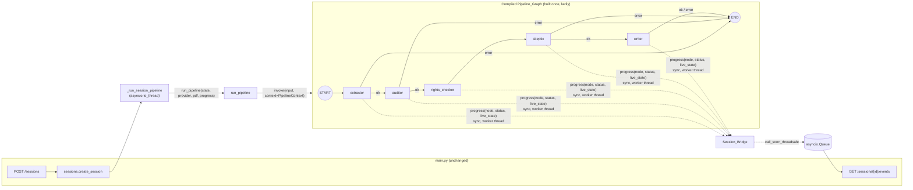
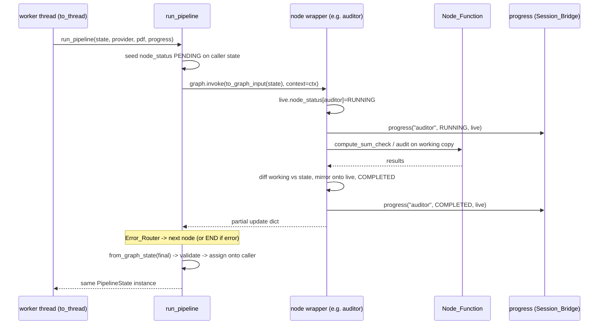

# Design Document: LangGraph Migration

## Overview

This design replaces the explicit sequential runner in `backend/pipeline/graph.py` with a compiled LangGraph `StateGraph`. The public entry point keeps its name and signature, `run_pipeline(state, provider, pdf_source, progress=None, kb=None) -> PipelineState`. `sessions.py`, `main.py`, the SSE event shapes, and the frontend stay the same.

The migration is a re-hosting, not a rewrite:

- The five Node_Functions (`read_pdf_text` + `extract_bill`, `compute_sum_check` + `audit`, `run_rights_checker`, `apply_skeptic`, `write_analysis`) are not modified. Thin node wrappers in `graph.py` call them.
- The node-fatal (Extractor, Auditor, Skeptic, Writer) and node-local (Rights_Checker) error behaviors move from `_run_node` / `_run_node_local` control flow into node wrappers plus conditional edges (the Error_Router).
- Progress transitions are still emitted synchronously on the worker thread, from inside each node wrapper, so the Session_Bridge (`loop.call_soon_threadsafe(queue.put_nowait, ...)`) sees the same event order as before.
- The provider and knowledge base are injected through LangGraph's runtime context (`context_schema`), so they never enter Graph_State.
- An optional letter-review interrupt (`LETTER_REVIEW_INTERRUPT`, off by default) compiles a second graph with `interrupt_before=["writer"]` and an in-memory checkpointer. It is a documented design option and does not change the HTTP contract or the `/confirm` gate.

### Research findings

Verified in a throwaway Python 3.14.3 venv (`/tmp/lgprobe`, deleted after the probe; `backend/.venv` was not modified):

| Topic | Finding |
|---|---|
| Version | `langgraph==1.2.17` is the latest release on PyPI and installs cleanly on Python 3.14.3 with `pydantic==2.14.1` (the project's current pin). |
| Direct requirements of `langgraph` 1.2.17 | `langchain-core>=1.4.7,<2`, `langgraph-checkpoint>=4.3.0,<5`, `langgraph-prebuilt>=1.1.0,<1.2`, `langgraph-sdk>=0.4.6,<0.5`, `pydantic>=2.7.4`, `xxhash>=3.5.0`. |
| Resolved transitive set | About 30 packages, including `langchain-core 1.7.0`, `langgraph-checkpoint 4.3.0`, `langgraph-prebuilt 1.1.1`, `langgraph-sdk 0.4.9`, `langsmith 0.14.12`, `ormsgpack`, `orjson`, `zstandard`, `httpx2`/`httpcore2`, `websockets`. |
| State schema | `StateGraph(PipelineState, context_schema=PipelineContext)` accepts a Pydantic v2 model with `extra="forbid"`. Nodes receive a validated model instance and return partial `dict` updates. `invoke` returns a plain `dict`. Keys that were never written (fields left at a `None` default) can be missing from that dict. `Decimal("1.50")` keeps its value and scale. |
| Unknown update keys | A node update with a key outside the schema is dropped silently. LangGraph does not reject it. The runner therefore does its own strict `PipelineState.model_validate` when converting (Req 2.7). |
| Context injection | A node with the signature `(state, runtime: Runtime[PipelineContext])` gets `runtime.context` from `graph.invoke(input, context=PipelineContext(...))`. The context is not part of the state or the checkpoints. See the [LangGraph runtime context docs](https://docs.langchain.com/oss/python/concepts/context) and the [StateGraph reference](https://reference.langchain.com/python/langgraph/graph/state/StateGraph). |
| Threading | A sync `invoke` of a linear graph runs each node inline on the calling thread. Under `asyncio.to_thread` that is the worker thread (observed `asyncio_0`), so callbacks fired inside a node run before the next node starts. |
| Topology introspection | `compiled.get_graph()` exposes `.nodes` (with `__start__` and `__end__`) and `.edges`, each with `source`, `target`, and `conditional`. Conditional edges appear once per declared `path_map` target. |
| Interrupts | `compile(checkpointer=InMemorySaver(), interrupt_before=["writer"])` pauses before `writer`. `get_state(cfg).next == ("writer",)` while paused. `invoke(None, cfg)` resumes. After completion `next == ()`, and calling `invoke(None, cfg)` again returns the final values without running nodes. An unknown thread raises `EmptyInputError`. `InMemorySaver.delete_thread` exists. `Command(resume=...)` applies only to dynamic `interrupt()` calls inside a node, which this design does not use. |
| Checkpoint serde | Restoring project Pydantic models and Enums from `InMemorySaver` logs "Deserializing unregistered type ..." and is slated to be blocked in a future version. The fix is `InMemorySaver(serde=JsonPlusSerializer(allowed_msgpack_modules=[...]))` listing the `models` and `pipeline.state` types. |
| LangSmith | `langsmith` is installed transitively. It only traces when `LANGSMITH_TRACING`/`LANGCHAIN_TRACING_V2` is set. `backend/.env` sets neither. |

Content was rephrased for compliance with licensing restrictions.

### Design decisions

1. **Use `PipelineState` itself as the Graph_State schema.** This meets Req 2.1 by construction (same 11 fields, same types, same optionality, `extra="forbid"`) and avoids keeping a parallel TypedDict in sync. A unit test still asserts the field-for-field match, so Req 2.1 holds even if someone later replaces the schema.
2. **Mirror updates onto the live caller instance during the run.** `sessions.Session.progress` and the SSE initial snapshot read `session.state.node_status` while the pipeline runs, and the Progress_Callback receives the caller's instance. Each wrapper therefore applies its update both to the graph (as the returned dict) and to the caller's `PipelineState` (held in the runtime context, never in Graph_State). At `END` the runner validates the final Graph_State and assigns it onto the caller's instance, which is the same object it returns.
3. **Run each node on a deep copy and diff.** Each wrapper runs the Node_Function against `working = state.model_copy(deep=True)` and returns the fields that changed. This keeps partial writes that happen before a failure. For example, the pre-migration Extractor sets `raw_text` before `extract_bill` raises, and the Rights_Checker may append before an unexpected exception. Keeping these writes makes the final state field-for-field equal to the Pre_Migration_Runner (Req 3.7).
4. **Use a static `interrupt_before=["writer"]` for the optional review.** A dynamic `interrupt()` would need either a sixth node or a change to the Writer wrapper's contract. The static interrupt keeps exactly five nodes (Req 3.1) and leaves the Writer untouched.
5. **Pin `langgraph` and `langgraph-checkpoint`.** `graph.py` imports `langgraph.graph`, `langgraph.runtime`, and, for the interrupt option, `langgraph.checkpoint.memory` and `langgraph.checkpoint.serde.jsonplus`. Those last two come from the `langgraph-checkpoint` distribution. Per Req 1.4 and 1.6, both are pinned identically in both dependency files. `langchain-core`, `langgraph-prebuilt`, `langgraph-sdk`, and `langsmith` are not imported directly, so they are not pinned (Req 1.6) and `langgraph`'s own ranges resolve them. If the interrupt option is dropped from implementation scope, the `langgraph-checkpoint` pin is dropped with it.

## Architecture



The Error_Router is attached to all four node-fatal nodes (`extractor`, `auditor`, `skeptic`, `writer`). For `writer`, both outcomes map to `END`, but the edge still goes through the router so that Req 5.2 ("route to END through the Error_Router") holds literally. `rights_checker` has a single plain edge to `skeptic` because it can never be fatal (Req 5.9, 6.2).

### Run sequence (success path)



## Components and Interfaces

### `backend/pipeline/graph.py` (rewritten internals, same public surface)

Kept as-is: `NODE_ORDER`, `TOTAL_NODES`, `LLMProvider` (local Protocol), `ProgressCallback`, `_get_knowledge_base()` (lazy KB singleton), `_emit()` (records status and swallows callback exceptions), `_seed_node_status()`, and the `run_pipeline` signature.

The import-time contract holds (Req 4.7). The module imports `langgraph.graph` / `langgraph.runtime` at top level, which is cheap and does no network I/O. It does not build the graph, the KB, or the provider at import. `langgraph.checkpoint.*` is imported lazily inside the interrupt builder.

New pieces:

```python
@dataclass(frozen=True)
class PipelineContext:
    """Per-run dependencies injected via LangGraph runtime context (never in state)."""
    provider: LLMProvider
    kb: "KnowledgeBase"
    pdf_source: Any
    live_state: PipelineState              # caller's instance, mirrored live
    progress: Optional[ProgressCallback]

def _apply_update(live: PipelineState, update: dict) -> None:
    """Validate `update` against PipelineState, then setattr each field on `live`."""

def _diff(before: PipelineState, after: PipelineState) -> dict:
    """Return {field: value} for fields whose value changed (by ==) on the working copy."""

def _fatal_node(node: NodeName, body: Callable[[PipelineState, PipelineContext], None]):
    """Build a node-fatal wrapper (extractor, auditor, skeptic, writer)."""

def _local_node(node: NodeName, body: ...):
    """Build the node-local wrapper (rights_checker)."""

def _route_after(node: NodeName) -> Callable[[PipelineState], str]:
    """Error_Router: END if state.error is not None else the next node in NODE_ORDER."""

def _build_graph() -> StateGraph: ...
def get_compiled_graph() -> CompiledStateGraph:          # lazy, compiled once, lock-guarded
def get_review_graph() -> CompiledStateGraph:            # interrupt variant (optional)

def to_graph_input(state: PipelineState) -> dict: ...
def from_graph_state(values: Mapping[str, Any]) -> PipelineState: ...

def run_pipeline(state, provider, pdf_source, progress=None, kb=None) -> PipelineState: ...
def resume_letter_review(session_id: str, state: PipelineState, provider, progress=None, kb=None) -> PipelineState: ...
class NoPausedRunError(RuntimeError): ...
```

#### Node bodies (operate on the working copy, unchanged logic)

| Node | Body (same calls and order as the pre-migration `_run_*`) |
|---|---|
| extractor | `w.raw_text = extractor.read_pdf_text(ctx.pdf_source)`, then `w.bill = extract_bill(ctx.pdf_source, ctx.provider)`. `read_pdf_text` is looked up as a module attribute at call time so the existing `monkeypatch.setattr(extractor_mod, "read_pdf_text", ...)` tests keep working. |
| auditor | `w.sum_check = compute_sum_check(w.bill)`, then `w.findings = audit(w.bill, w.sum_check)`, then `w.retained_findings = list(w.findings)` (a distinct list, Req 3.3). No provider access. |
| rights_checker | `run_rights_checker(w, ctx.kb)`, called exactly once. It does not touch `retained_findings` (Req 3.10). |
| skeptic | `w.retained_findings = apply_skeptic(w.findings)`. `findings` is untouched. No provider access. |
| writer | `w.result = write_analysis(w.retained_findings, w.language, ctx.provider)`, called exactly once. |

#### Fatal wrapper lifecycle

```python
def wrapper(state: PipelineState, runtime: Runtime[PipelineContext]) -> dict:
    ctx = runtime.context
    _emit(ctx.progress, node, NodeStatus.RUNNING, ctx.live_state)        # Req 7.1
    working = state.model_copy(deep=True)
    working.node_status[node.value] = NodeStatus.RUNNING
    try:
        body(working, ctx)
        status, err = NodeStatus.COMPLETED, None
    except (ExtractorError, WriterError) as exc:
        status, err = NodeStatus.ERROR, exc.to_state_error()             # Req 5.1, 5.2
    except Exception as exc:
        status, err = NodeStatus.ERROR, {"failedNode": node.value, "message": str(exc)}  # Req 5.3
    update = _diff(state, working)                                       # keeps partial writes
    update["node_status"] = {**state.node_status, node.value: status}
    if err is not None:
        update["error"] = err
    _apply_update(ctx.live_state, update)   # mirror before notifying
    _emit(ctx.progress, node, status, ctx.live_state)                    # Req 7.2, 7.3
    return update
```

`_emit` sets `live.node_status[node]` and calls the callback inside `try/except Exception: pass` (Req 7.6). The wrapper never raises, so LangGraph never sees an exception and `run_pipeline` returns normally (Req 5.7).

The `str(exc)` message shape is identical to the Pre_Migration_Runner (Req 5.3). Provider-originated failures reach the graph only as `ExtractorError` / `WriterError`, whose `to_state_error()` messages are fixed generic strings, so no key or provider body text reaches `error.message` (Req 5.8). Property 9 guards this.

#### Local wrapper (rights_checker)

The local wrapper has the same lifecycle, except any exception from the body sets `working.rights_status = RightsStatus.UNAVAILABLE`. The final status is always `COMPLETED`, and `error` is never written (Req 6.1, 6.2, 7.4). The ordinary failure, empty, timeout, empty-query, and no-bill cases are already absorbed inside `run_rights_checker`.

#### Error_Router and edges

```python
g = StateGraph(PipelineState, context_schema=PipelineContext)
for node in NODE_ORDER:
    g.add_node(node.value, WRAPPERS[node])
g.add_edge(START, "extractor")                                   # Req 4.1
for node, nxt in [(EXTRACTOR, AUDITOR), (AUDITOR, RIGHTS_CHECKER), (SKEPTIC, WRITER)]:
    g.add_conditional_edges(node.value, _route_after(node), {nxt.value: nxt.value, END: END})
g.add_edge("rights_checker", "skeptic")                          # Req 5.9, 6.2
g.add_conditional_edges("writer", _route_after(WRITER), {END: END})  # both outcomes -> END
```

The success-path successor of each node is `NODE_ORDER[i+1]`, or `END` after `writer` (Req 4.3, 4.4). The only other edges are the Error_Router's edges to `END`. The router is a pure function of `state.error`, so it adds no branching on the success path.

#### Compile once, thread safety

`get_compiled_graph()` uses a module-level `_COMPILED` and a `threading.Lock` with double-checked initialization, so concurrent first calls from two worker threads compile exactly once (Req 4.5). The compiled graph has no checkpointer, and all per-run data lives in the `invoke` input and the `PipelineContext`. Concurrent runs on separate threads share no mutable state (Req 4.6). `_get_knowledge_base()` gets the same lock treatment so a first-call race cannot build the KB twice.

#### `run_pipeline`

```python
def run_pipeline(state, provider, pdf_source, progress=None, kb=None):
    _seed_node_status(state)
    resolved_kb = kb if kb is not None else _get_knowledge_base()
    ctx = PipelineContext(provider, resolved_kb, pdf_source, state, progress)
    graph = get_review_graph() if letter_review_enabled() else get_compiled_graph()
    config = {"configurable": {"thread_id": state.session_id}} if letter_review_enabled() else None
    final = graph.invoke(to_graph_input(state), config, context=ctx)
    validated = from_graph_state(final)          # raises ValidationError, caller untouched (Req 2.7)
    for name in PipelineState.model_fields:
        setattr(state, name, getattr(validated, name))
    return state                                  # identity preserved (Req 2.3, 2.6)
```

`to_graph_input` returns `{name: deepcopy(getattr(state, name)) for name in model_fields}`. `from_graph_state` fills omitted keys with the caller's current value (which matches the mirrored value). It rejects any key outside `model_fields` and validates the result with `PipelineState.model_validate`, so a validation failure leaves the caller's instance untouched.

The KB is resolved before `invoke`, preserving the pre-migration lazy build. Building the KB raising is outside any node, so the Session_Bridge's existing defensive `except` handles it (Req 7.9).

### `backend/sessions.py`

No change is needed for the default path. It keeps calling `run_pipeline(state, provider, pdf_source, progress)` via `asyncio.to_thread` (Req 7.10). `_make_progress_bridge` and `_progress_event` are unchanged, so payload shapes are unchanged (Req 7.8).

For the interrupt option only, `_run_session_pipeline` skips the terminal `done` when the returned state is paused (`writer` still `PENDING`, `error is None`, `result is None`). A new internal coroutine, `resume_session_pipeline(session_id)`, runs `resume_letter_review` via `asyncio.to_thread` and then enqueues `done`. It is not wired to any route (Req 9.8).

### `backend/config.py`

This file adds the interrupt flag using the existing `ConfigError` pattern:

```python
LETTER_REVIEW_INTERRUPT_VAR = "LETTER_REVIEW_INTERRUPT"
_TRUE = {"1", "true", "yes", "on"}; _FALSE = {"0", "false", "no", "off"}

def parse_bool_flag(name: str, raw: Optional[str]) -> bool:
    """Absent/empty -> False; case-insensitive recognized values; else ConfigError naming `name` only."""

def load_pipeline_options(env: Optional[Mapping[str, str]] = None) -> PipelineOptions:
    """Read LETTER_REVIEW_INTERRUPT from backend/.env overlaid by os.environ (same _resolve_source rules)."""
```

The `ConfigError` message is `"Invalid LETTER_REVIEW_INTERRUPT value. Use true or false."`. It names only the variable and never echoes any value (Req 9.10). `main.lifespan` calls `load_pipeline_options()` next to `load_config()` and stores the result once via `pipeline.graph.configure(options)`. A process that never calls `configure`, such as the test suite, gets the default `False` (Req 9.1).

### `backend/requirements.txt` and `backend/pyproject.toml`

Add the same two lines to both (Req 1.1, 1.2, 1.4). Existing pins are unchanged (Req 1.5).

```
langgraph==1.2.17
langgraph-checkpoint==4.3.0
```

### Test helpers

- `backend/pipeline/_reference_runner.py`: a verbatim copy of the Pre_Migration_Runner (`_emit`, `_seed_node_status`, `_run_*`, `_run_node`, `_run_node_local`, `run_pipeline` renamed `run_pipeline_reference`), taken from the pre-migration commit. It imports the same Node_Functions, so equivalence tests compare orchestration only. The leading underscore keeps pytest from collecting it.
- `backend/pipeline/_graph_fixtures.py`: Hypothesis strategies for synthetic bills (line items with `Decimal` two-decimal amounts, codes, duplicates, stated-total mismatches), scenario selection, and stub providers and KBs.

## Data Models

### Graph_State

The Graph_State is `pipeline.state.PipelineState`, unchanged:

| Field | Type | Default | Written by |
|---|---|---|---|
| `session_id` | `str` | required | caller |
| `language` | `SupportedLanguage` | required | caller |
| `raw_text` | `Optional[str]` | `None` | extractor |
| `bill` | `Optional[ExtractedBill]` | `None` | extractor |
| `sum_check` | `Optional[SumCheckResult]` | `None` | auditor |
| `findings` | `list[Finding]` | `[]` | auditor, rights_checker |
| `retained_findings` | `list[Finding]` | `[]` | auditor (provisional), skeptic |
| `rights_status` | `RightsStatus` | `COMPLETED` | rights_checker |
| `result` | `Optional[AnalysisResult]` | `None` | writer |
| `node_status` | `dict[str, NodeStatus]` | `{}` | every wrapper |
| `error` | `Optional[dict]` | `None` | fatal wrappers |

No reducers are declared. Every channel is last-value-wins, which matches the sequential overwrite semantics because exactly one node runs per step. Wrappers return the full new value of `findings` and `node_status`, not deltas.

Money stays `Decimal` everywhere. Nothing is serialized during a run without a checkpointer. With `InMemorySaver`, `JsonPlusSerializer` round-trips `Decimal`, Pydantic models, and Enums natively, with the allow-list described above.

### PipelineContext (runtime context, never checkpointed)

`provider`, `kb`, `pdf_source`, `live_state`, and `progress`, as shown above. It is a frozen dataclass passed via `invoke(..., context=...)`. LangGraph does not persist context to checkpoints. This keeps the provider, which holds the API key, out of Graph_State and out of the checkpointer (Req 3.8).

### Conversion contract

- `to_graph_input(ps) -> dict`: exactly the 11 field names, with deep-copied values.
- `from_graph_state(values) -> PipelineState`: raises `pydantic.ValidationError` for unknown keys or bad types (Req 2.7).
- Round trip: `from_graph_state(to_graph_input(ps)) == ps` for every valid `ps` (Req 2.4).

### Letter_Review_Interrupt (design option, off by default)

This section addresses Req 9.7.

- **Setting.** `LETTER_REVIEW_INTERRUPT=true` in `backend/.env` (or the process env). Absent or empty means disabled. Unrecognized values abort startup with `ConfigError`.
- **Graph.** `get_review_graph()` compiles the same `StateGraph` builder with `checkpointer=InMemorySaver(serde=JsonPlusSerializer(allowed_msgpack_modules=[...project types...]))` and `interrupt_before=["writer"]`, once per process. It is only used when the flag is on. With the flag off, nothing from `langgraph.checkpoint` is imported and the default graph has no checkpointer (Req 9.2).
- **Thread id.** `thread_id = session_id`.
- **Pause.** After `skeptic` completes, `invoke` returns with `get_state(cfg).next == ("writer",)`. `writer` stays `PENDING` and `result` stays `None`, so no summary and no letter exist yet (Req 9.3). `run_pipeline` returns the caller's instance in that paused state.
- **What the client observes.** The SSE stream shows four completed nodes (`completedCount: 4`, `activeNode: null`) and then stays open with no `done`. `GET /sessions/{id}/result` returns `{"status": "running", "progress": {...}}`. `/confirm` cannot be meaningfully used because the client has no letter to show. The HTTP surface is the same (Req 9.8).
- **Resume.** `resume_letter_review(session_id, state, provider, progress, kb)` checks `get_state(cfg).next == ("writer",)`. If it isn't, it raises `NoPausedRunError("No paused run exists for this session.")` before touching any state (Req 9.9). If it is, it calls `graph.invoke(None, cfg, context=ctx)`, which runs only `writer` (Req 9.4), then converts and assigns onto the caller's instance and calls `checkpointer.delete_thread(session_id)` so no Graph_State is kept after completion. Human input is an approval signal only. The Writer contract and the English-letter rule are unchanged, so nothing from the reviewer is written into Graph_State. The resume entry point is a Python function, not an HTTP route.
- **Storage.** The checkpointer lives in process memory only. It does no disk or DB writes and is gone when the process stops (Req 9.5).
- **Confirm flow.** Resuming produces the draft letter. It never sets `session.confirmed_letter`. `POST /sessions/{id}/confirm` remains the only gate before export (Req 9.6, 8.7).

## Correctness Properties

*A property is a characteristic or behavior that should hold true across all valid executions of a system-essentially, a formal statement about what the system should do. Properties serve as the bridge between human-readable specifications and machine-verifiable correctness guarantees.*

"Reference" means `run_pipeline_reference` in `pipeline/_reference_runner.py`, the Pre_Migration_Runner. "Scenario" covers success, Rights_Checker failure (raise, empty, timeout, unexpected exception), Extractor failure, Auditor failure, Skeptic failure, and Writer failure. Scenarios are driven by stub providers, stub KBs, and monkeypatched Node_Functions.

The reflection step merged overlapping criteria. Identity, Decimal preservation, partial-write retention, node order, and success routing all follow from Property 1. Payload shapes, the single terminal `done`, and the unavailable-run event stream all follow from Property 2.

### Property 1: Model-based equivalence with the Pre_Migration_Runner

*For any* synthetic bill (the 10 eval-set bills plus Hypothesis-generated bills), session language, and scenario, running `run_pipeline` and the reference on separate fresh `PipelineState`s with the same inputs gives the following. The returned object is the caller's instance. The two final states are equal by `model_dump()`, which covers `node_status`, `rights_status`, `error`, partial writes such as `raw_text` on an Extractor failure, and `Decimal` values compared with `str()` to also check scale. The ordered lists of `(node_name, status)` Progress_Callback transitions are identical.

**Validates: Requirements 2.3, 2.5, 2.6, 3.7, 3.9, 4.2, 5.6, 7.2, 9.2**

### Property 2: Event_Sequence equivalence through the Session_Bridge

*For any* synthetic bill and any of the four scenarios (success, Rights_Checker failure, Extractor failure, Writer failure), the `(event_type, data)` items placed on the session queue by `_run_session_pipeline` equal those produced when the reference runner is driven through the same bridge. Concretely: success gives 10 `progress` then `done`; Rights_Checker failure gives 10 `progress`, no `node_error`, then `done`; Extractor failure gives 1 `progress`, 1 `node_error`, then `done`; Writer failure gives 9 `progress`, 1 `node_error`, then `done`. Every `progress` payload has exactly the keys `{activeNode, completedNodes, completedCount, total}` with `total == 5` and `completedCount == len(completedNodes)`. Every `node_error` payload has exactly `{failedNode, message}`. `("done", None)` occurs exactly once, as the last item.

**Validates: Requirements 6.7, 7.7, 7.8, 7.9, 8.4, 10.6**

### Property 3: Graph_State conversion round trip

*For any* valid `PipelineState` (generated with arbitrary bills, findings lists, `node_status` maps, rights statuses, results, and errors), `from_graph_state(to_graph_input(ps))` equals `ps` on all 11 fields. Every money amount in the result is a `Decimal` with the same value and the same exponent, and list order and `node_status` keys are preserved.

**Validates: Requirements 2.4, 2.5**

### Property 4: Invalid conversion is rejected without side effects

*For any* valid caller `PipelineState` and any Graph_State values corrupted by adding a key outside the 11 fields or by replacing one field with a value of the wrong type, the conversion raises `pydantic.ValidationError`. The caller's instance then still equals a `model_copy(deep=True)` snapshot taken before the attempt.

**Validates: Requirements 2.7**

### Property 5: Node-fatal failure invariants

*For any* synthetic bill, any fatal node `n` in {extractor, auditor, skeptic, writer}, and any failure (the typed `ExtractorError`/`WriterError`, or an arbitrary exception with an arbitrary message), `run_pipeline` returns without raising and the following hold:

- `error` equals `to_state_error()` for typed errors, or `{"failedNode": n, "message": str(exc)}` otherwise.
- `node_status[n] == ERROR` and it is the only `ERROR`.
- Every earlier node is `COMPLETED` and every later node is `PENDING`.
- `result` is unchanged from before `n`.
- Later nodes make zero provider calls.
- The callback transition list ends with exactly one `(n, ERROR)` and nothing after it.

**Validates: Requirements 5.1, 5.2, 5.3, 5.4, 5.5, 5.7, 7.3**

### Property 6: Rights_Checker failures are node-local

*For any* synthetic bill and any Rights_Checker failure mode (KB raises, KB returns no passages, KB exceeds the retrieval budget, with `RETRIEVAL_TIMEOUT_S` monkeypatched low, empty built query, missing bill, or `run_rights_checker` raising an arbitrary exception), the run sets `rights_status == UNAVAILABLE`. `rights_checker`, `skeptic`, and `writer` all end `COMPLETED`. `error is None` and `result is not None`. `findings` equals the auditor-only findings in the same order with zero `rights_issue` Findings. No `(rights_checker, ERROR)` transition is emitted.

**Validates: Requirements 3.11, 5.9, 6.1, 6.2, 6.3, 6.4, 7.4**

### Property 7: Rights retrieval threshold and top-3 selection through the graph

*For any* synthetic bill and any list of KB passages with arbitrary ids and raw scores, the `rights_issue` Findings appended after the auditor Findings correspond, in order, to at most the 3 highest-scoring passages whose normalized relevance is at least 0.7, with ties broken by ascending passage id. If no passage reaches 0.7, zero are appended. In both cases `rights_status == COMPLETED`.

**Validates: Requirements 6.5, 6.6**

### Property 8: Pure-node contracts

*For any* synthetic bill whose run reaches the Writer:

- `sum_check == compute_sum_check(bill)`.
- The auditor-produced prefix of `findings` equals `audit(bill, sum_check)`.
- The auditor node's update carries a `retained_findings` list that is equal to, but a different object from, its `findings`.
- The final `retained_findings == apply_skeptic(findings)`, and `findings` is unchanged by the skeptic node.
- A call-counting stub provider records zero calls while `auditor` or `skeptic` is the RUNNING node.

**Validates: Requirements 3.3, 3.4, 3.6**

### Property 9: No dependencies or secrets in state or error messages

*For any* scenario, with a stub provider carrying a random sentinel API key and returning or raising text that contains a random sentinel body string, the following hold:

- No streamed graph update and no field of the final state contains the provider object, the KB object, the sentinel key, or the sentinel body text. Values are checked by object identity and by substring search over `model_dump_json()`.
- No `error.message` contains the sentinel key or body text.

**Validates: Requirements 3.8, 5.8, 8.8**

### Property 10: RUNNING is announced before the node body runs

*For any* synthetic bill and success or failure scenario, every provider call made by node `n` happens after the Progress_Callback received `(n, RUNNING)` and after `live_state.node_status[n] == RUNNING`, and before any later transition for `n`. A recording stub provider captures the last transition at call time.

**Validates: Requirements 7.1, 7.2**

### Property 11: Progress-callback exceptions do not change the outcome

*For any* synthetic bill, scenario, and subset of transition indices at which the callback raises, the final `result`, `error`, `node_status`, and the full `model_dump()` equal those of the same run with a non-raising callback.

**Validates: Requirements 7.6**

### Property 12: Concurrent runs are isolated

*For any* pair of synthetic bills with different session ids, running both through `run_pipeline` concurrently on two threads (with a barrier inside the stub provider to force interleaving) gives each caller a state equal to what that caller's input gives when run alone. That includes `session_id`, findings, `node_status`, and `result`.

**Validates: Requirements 4.6**

### Property 13: Pause then resume equals an uninterrupted run

*For any* synthetic bill whose run reaches the Writer, with the Interrupt_Option enabled, the first `run_pipeline` call returns with `writer == PENDING`, `result is None`, and `get_state(cfg).next == ("writer",)`. A single `resume_letter_review` for the same session id then gives a final state equal to the uninterrupted default-graph run on the same inputs. During the resume, the extractor, auditor, rights_checker, and skeptic wrappers run zero times.

**Validates: Requirements 9.3, 9.4, 10.9**

### Property 14: Resume without a paused run is rejected

*For any* set of sessions where each thread id is unknown, already resumed, or completed, `resume_letter_review` raises `NoPausedRunError`, runs no wrapper (spy count 0), and leaves every session's `PipelineState` and checkpointer state equal to snapshots taken before the call.

**Validates: Requirements 9.9**

### Property 15: Interrupt flag parsing

*For any* string value of `LETTER_REVIEW_INTERRUPT`:

- Absent, empty, or whitespace-only gives `False`.
- A case-insensitive member of {1, true, yes, on} gives `True`, and a member of {0, false, no, off} gives `False`.
- Any other value raises `ConfigError`. Its message contains `LETTER_REVIEW_INTERRUPT`, and contains neither the supplied value (when non-trivial) nor the configured `LLM_API_KEY` value.

**Validates: Requirements 9.1, 9.10**

## Error Handling

| Failure | Where caught | State effect | Routing | Events |
|---|---|---|---|---|
| `ExtractorError` / `WriterError` | fatal wrapper | `error = exc.to_state_error()`, node `ERROR`, partial writes kept | Error_Router to `END` | `progress` (RUNNING) then `node_error` |
| Any other exception in extractor, auditor, skeptic, or writer | fatal wrapper | `error = {failedNode, str(exc)}`, node `ERROR` | Error_Router to `END` | same |
| Rights retrieval error, empty result, timeout, empty query, no bill | inside `run_rights_checker` (unchanged) | `rights_status = UNAVAILABLE`, node `COMPLETED` | edge to `skeptic` | 2 `progress`, no `node_error` |
| Unexpected exception from `run_rights_checker` | local wrapper | same as above, partial appends kept (matches pre-migration) | edge to `skeptic` | same |
| Progress_Callback raises | `_emit` | none; transition still recorded | unchanged | that event may be missing (pre-migration behavior) |
| KB build or graph compile raises (outside nodes) | `sessions._run_session_pipeline` defensive `except` | `error = {failedNode: "pipeline", ...}` | n/a | `node_error` then `done` |
| Final Graph_State fails validation | `from_graph_state` | caller instance untouched | n/a | raises to `_run_session_pipeline`, which handles it as the row above |
| Invalid `LETTER_REVIEW_INTERRUPT` | `config.load_pipeline_options` at startup | process does not start | n/a | `ConfigError` naming only the variable |
| Resume with no paused run | `resume_letter_review` pre-check | none | no node runs | `NoPausedRunError` (internal only) |

Client-facing messages are the same generic strings as before. `main.py` and the SSE relay are unchanged, so no stack traces, provider headers or bodies, or the API key reach clients. `langsmith` is never configured. The test suite's autouse fixture deletes `LANGSMITH_TRACING`, `LANGCHAIN_TRACING_V2`, and `LANGSMITH_API_KEY` from the environment so the transitive tracer cannot make network calls.

## Testing Strategy

### Dual approach

- **Property tests** (Hypothesis, already pinned at `hypothesis==6.170.9`) cover Properties 1–15. Each property is one `@given` test with `@settings(max_examples=100, deadline=None)`. The exceptions are Property 2, which uses at least 50 examples per Req 10.6 and is configured for 100 anyway, and Property 12, which uses 25 examples because threads make it slower (stated in the test). Each test carries a tag comment:
  `# Feature: langgraph-migration, Property 1: Model-based equivalence with the Pre_Migration_Runner`
- **Example and topology tests** cover the structural and one-shot criteria.
- **Existing suite.** All 71 pre-existing tests must pass unmodified (Req 10.1). The requirements note that an older figure of 52 is stale; the current collected count is 71.

### Test files (all in `backend/pipeline/`, collected by `.venv/bin/python -m pytest -q`)

| File | Contents |
|---|---|
| `graph_topology_test.py` | Req 10.2–10.5. `get_compiled_graph().get_graph()` has nodes `{__start__, extractor, auditor, rights_checker, skeptic, writer, __end__}`. The edge set is exactly `__start__→extractor`, `extractor→{auditor, __end__}`, `auditor→{rights_checker, __end__}`, `rights_checker→skeptic`, `skeptic→{writer, __end__}`, `writer→__end__`, with `conditional` flags as designed. Also covers: the success run order via stream updates (`stream_mode="updates"` yields node keys in order); one fatal case per node (stub provider for extractor and writer, monkeypatched `pipeline.graph.audit` / `apply_skeptic` for auditor and skeptic); four rights-failure cases; `NODE_ORDER` and `TOTAL_NODES`; compile-once (reset `_COMPILED`, spy `StateGraph.compile`, two runs plus two concurrent first calls give one compile); Graph_State field set equal to `PipelineState.model_fields`; default graph `checkpointer is None`. |
| `graph_equivalence_test.py` | Properties 1, 5, 6, 7, 8, 9, 10, 11, 12. |
| `graph_state_conversion_test.py` | Properties 3, 4. |
| `graph_events_test.py` | Property 2 (async, with a real `asyncio.Queue` and `_make_progress_bridge`). Req 7.5 integration example: the writer stub blocks on a `threading.Event`, the test polls the queue until the writer `RUNNING` progress appears, then releases. Req 7.9 example: KB builder raises, giving `node_error` then `done`. |
| `graph_interrupt_test.py` | Properties 13, 14. Flag-disabled example (Req 10.9). Req 8.7 and 9.6 example (`confirmed_letter is None` after resume). Req 9.8 example (`app.routes` identical with the flag on and off). Req 9.5 smoke (checkpointer is `InMemorySaver`, thread deleted after resume). |
| `backend/config_pipeline_options_test.py` | Property 15 (lives next to `config.py`). |
| `deps_test.py` (in `backend/`) | Req 1.1, 1.2, 1.4, 1.5, 1.6. Parse `requirements.txt` and `pyproject.toml` (`tomllib`). AST-scan `pipeline/graph.py` for `langgraph*` imports, map module prefixes to distributions (`langgraph.checkpoint` maps to `langgraph-checkpoint`, anything else under `langgraph.` maps to `langgraph`), and assert the declared langgraph-family set equals the imported set with identical `==` pins. Assert all pre-migration pins are present. |
| `graph_import_test.py` | Req 4.7. Run `import pipeline.graph` in a subprocess with `socket.socket` patched to raise and `rag.knowledge_base.KnowledgeBase` / `llm.provider.build_provider` patched to raise. The import must succeed, and `_COMPILED` and `_KNOWLEDGE_BASE` must still be `None`. |

### Generators and stubs (`pipeline/_graph_fixtures.py`)

- `synthetic_bills()`: 1–12 line items with codes from a small pool (so duplicates happen), `Decimal` amounts quantized to `0.01` in `[0.01, 99999.99]`, and an optional stated-total mismatch. The strategy outputs the stub Extractor's JSON plus fake PDF text, and `read_pdf_text` is monkeypatched at module level as the existing tests do. The 10 eval-set bills are added via `@example` or a parametrized companion.
- `scenarios()`: `sampled_from` over the scenario enum, plus arbitrary exception messages via `text()`.
- `StubProvider`: per-node scripted responses or raises, records `(node, live RUNNING node)` per call, and holds a sentinel `api_key` attribute for Property 9.
- `StubKB`: modes `match(passages)`, `empty`, `raise`, `slow` (blocks past the budget; tests `monkeypatch.setattr(rights_checker, "RETRIEVAL_TIMEOUT_S", 0.05)` so `_retrieve`'s `future.result(timeout=...)` trips without a 15 s sleep and without changing any Node_Function).

### Non-PBT checks

Req 1.3 (fresh-venv install), 3.2 (Node_Function sources unchanged), and 8.5 (frontend byte-for-byte unchanged) are verified in the final task with `python3.14 -m venv` + `pip install -r requirements.txt` + `python -c "import langgraph.graph"`, `git diff --exit-code <pre-migration-commit> -- backend/pipeline/{extractor,sumcheck,auditor,rights_checker,skeptic,writer}.py`, and `git diff --exit-code <pre-migration-commit> -- frontend/`.

### Safety constraints for tests

- Tests never call a real LLM. Every run injects a `StubProvider` or monkeypatches `sessions.get_provider`. An autouse fixture blocks `socket.socket.connect` for the new test modules (Req 10.7).
- Only synthetic bills are used. No real patient data appears in fixtures.
- `backend/.env` is never read for the flag in tests. Options are passed via `load_pipeline_options(env={...})` and `pipeline.graph.configure(...)`, and reset in teardown.
